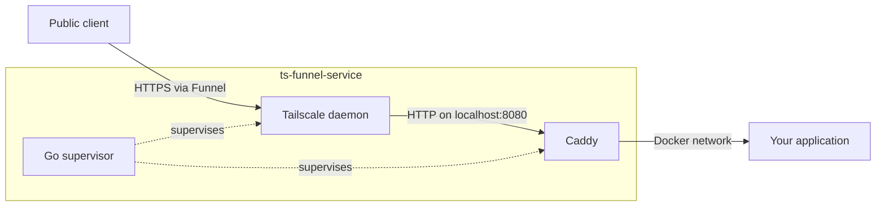

# How ts-funnel-service works

ts-funnel-service runs alongside an application and gives it a public HTTPS address through Tailscale Funnel. It combines Tailscale, Caddy and a Go supervisor in one container, without requiring a public IP or router port forwarding.

## Request flow

Tailscale handles the public `.ts.net` address, certificates and HTTPS termination. Caddy forwards requests to `SERVICE_NAME:SERVICE_PORT`, normally another container on the same Docker network. A custom Caddyfile can replace the generated proxy configuration.

## Startup and architecture

The Go supervisor is the container's main process. It loads settings and persisted state, validates and starts Caddy, starts Tailscale, enrolls a fresh node or reuses its identity, then enables Funnel forwarding. It supervises both children and handles shutdown.

A dedicated update engine manages signed Tailscale downloads, A/B binary/state slots and recovery records. Automatic updates are enabled by default. The candidate is prepared while traffic continues, followed by a brief daemon restart and validation. Failed handovers attempt rollback; Caddy stays running.

The container runs as an unprivileged user with userspace networking. It requires neither `NET_ADMIN` nor a TUN device.

## State and operations

Give each service its own persistent volume at `/var/lib/tailscale`. It retains the node identity, accepted runtime binaries and update history across container recreation.

The supervisor exposes `/metrics` separately on internal port 9090. Monitoring tools are optional. Supervisor/update logs appear in `docker logs` and rotating files; the log directory can be mounted separately.

- [Setup and configuration](../README.md)
- [Automatic updates, recovery and log mounts](automatic-updates.md)
- [Monitoring and shared Grafana dashboard](monitoring.md)
- [Testing and rollout validation](testing.md)
